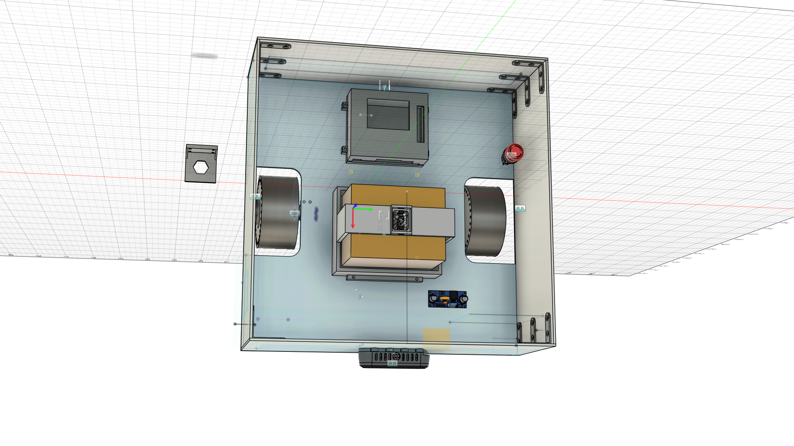
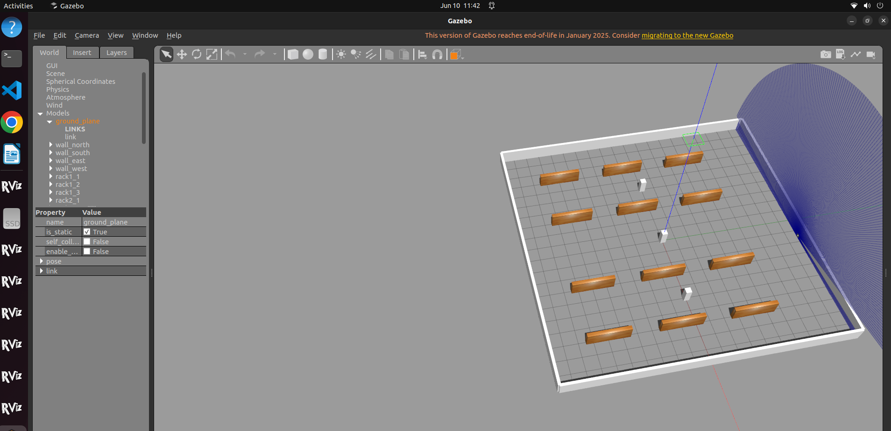
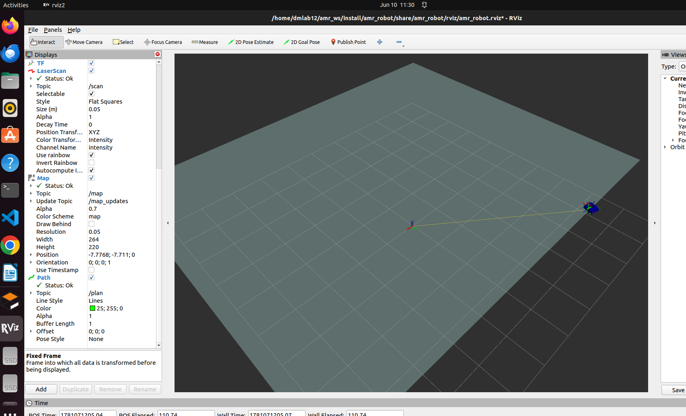
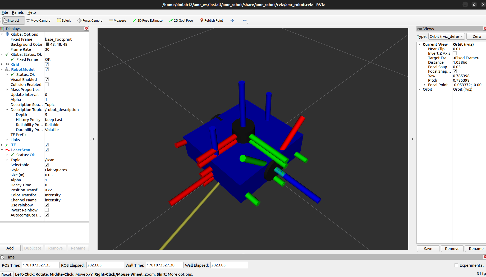

# Industrial Autonomous Mobile Robot (AMR)

### Full-Stack Mechanical Architecture (Fusion 360 DFM) & Autonomous Navigation Stack (ROS 2 Humble / Nav2 / SLAM Toolbox / Gazebo)

<p align="center">
  
</p>

<p align="center">
  <a href="https://docs.ros.org/en/humble/"></a>
  <a href="https://www.autodesk.com/products/fusion-360/"></a>
  <a href="https://gazebosim.org/"></a>
  <a href="https://navigation.ros.org/"></a>
  <a href="https://ubuntu.com/"></a>
  <a href="LICENSE"></a>
</p>

---

## 📌 Executive Summary

This repository hosts the complete engineering design, digital twin simulation, and autonomous navigation stack for an **Industrial Autonomous Mobile Robot (AMR)** engineered for intralogistics, material transfer, and smart factory floor operations. Developed during an engineering research internship at **IIT Delhi - Foundation for Smart Manufacturing (FSM)**.

The project bridges **mechanical product development (CAD/DFM)** and **autonomous robotics software engineering (ROS 2 Humble)**:
- **CAD & Mechanical DFM**: Designed a robust 4-point differential drive chassis in **Autodesk Fusion 360**, conducting multi-body interference validation, center-of-mass optimization, material selection (6061-T6 & 5052-H32 aluminium alloys, IS 2062 steel), and producing a **16-deliverable, 2-sheet GD&T production drawing package** ready for CNC milling and sheet-metal laser fabrication.
- **ROS 2 Autonomy & Simulation**: Engineered a production-grade **ROS 2 Humble** stack featuring a parameterized **URDF/Xacro** digital twin, hardware abstraction via **`ros2_control`**, 2D Graph SLAM via **`slam_toolbox`** (Ceres solver), and autonomous waypoint navigation via **Nav2** with **Regulated Pure Pursuit (RPP)** local control in a custom **20 × 20 m multi-rack warehouse Gazebo world**.

---

## 📸 Visual Showcase & Simulation Highlights

| **Mechanical Assembly (Fusion 360)** | **Warehouse Simulation (Gazebo Classic)** |
|:---:|:---:|
|  |  |
| *Master 3D Assembly (271.0 mm height, 318 × 347.5 mm footprint)* | *Custom 20×20m warehouse world with 12 pallet racks & support pillars* |

| **Occupancy Grid & Costmaps (RViz2)** | **Laser Raytracing & Kinematics** |
|:---:|:---:|
|  |  |
| *Live 2D SLAM occupancy grid with dynamic Nav2 costmap inflation* | *360° RPLiDAR raycasting and REP-105 compliant TF2 coordinate tree* |

---

## 🚀 Key Engineering Accomplishments

### 1. Mechanical Engineering & Design for Manufacturing (DFM)
- **Compact Industrial Envelope**: Designed an optimized chassis architecture measuring **318 mm (L) × 347.5 mm (W)** with a confirmed total assembly height of **271.0 mm** and a ground clearance of **25.0 mm**.
- **Dual-Caster Stability Geometry**: Configured a diamond 4-point ground contact system (2 direct-drive hub wheels + dual longitudinal passive casters) yielding dynamic tip-over margins exceeding $\theta_{\text{tip}} > 28^\circ$.
- **Critical Caster Interference Resolution**: Diagnosed a clearance conflict between the caster swivel envelope and side panel flange during multi-body CAD assembly validation. Redesigned bracket standoff offsets ($+14.5\text{ mm}$) and added 30° relief chamfers, eliminating interference while preserving structural base rigidity.
- **Multi-Material Strategy**:
  - **Aluminium 6061-T6**: Primary structural base plate and precision CNC sensor mounts (high strength-to-weight, rigidity).
  - **Aluminium 5052-H32**: Enclosure side and front panels (superior bendability without cracking, corrosion resistance).
  - **IS 2062 Structural Mild Steel**: Motor mount brackets and low-CoM battery retention cradle (fatigue resistance against motor torque transients).
- **Comprehensive GD&T Package**: Generated 16 production-grade, two-sheet manufacturing drawings detailing part tolerances, laser-cut kerf offsets ($0.20\text{ mm}$), and fastener hole callouts.

### 2. Autonomous Robotics & ROS 2 Navigation Architecture
- **Kinematic Modeling (URDF/Xacro)**: Authored a parameterized digital twin with exact mass properties, friction parameters (`mu1=1.2`, `mu2=1.2`), caster contact dynamics (`mu=0.001`), and inertia tensors calculated from CAD solid geometries.
- **Hardware Abstraction (`ros2_control`)**: Implemented `diff_drive_controller/DiffDriveController` and `joint_state_broadcaster/JointStateBroadcaster` running at a deterministic **50 Hz** update loop.
- **Sensor Fusion & Modeling**:
  - **2D LiDAR (RPLiDAR A1M8)**: Simulated via `libgazebo_ros_ray_sensor.so` publishing 720 samples/rev over $360^\circ$ at $10\text{ Hz}$ with Gaussian noise ($\sigma = 0.01\text{ m}$).
  - **9-DOF IMU**: Simulated via `libgazebo_ros_imu_sensor.so` publishing linear accelerations and angular velocities at $100\text{ Hz}$.
- **Graph-Based SLAM (`slam_toolbox`)**: Configured asynchronous 2D SLAM utilizing Ceres Levenberg-Marquardt non-linear optimization. Parameter-tuned `minimum_travel_distance` ($0.15\text{ m}$) and `minimum_travel_heading` ($0.174\text{ rad}$) to eliminate scan-stitching artifacts and drift in narrow warehouse corridors.
- **Nav2 Autonomous Navigation**:
  - **Global Planner**: `NavFn` executing Dijkstra/A* path generation on static global costmaps.
  - **Local Controller**: `RegulatedPurePursuitController` with curvature-based velocity scaling and proximity deceleration for collision-free trajectory tracking.
  - **Multi-Layer Costmaps**: 2-layer architecture (Obstacle Raytrace + Inflation) with an **inflation radius of $0.55\text{ m}$**, preventing hazardous wall-adjacent path generation.
- **Custom Warehouse World**: Built a realistic **20 × 20 m ($400\text{ m}^2$)** industrial facility in Gazebo Classic containing 12 heavy-duty storage racks arranged in 4 columns and 3 structural columns.

---

## 🛠️ System Specifications

```
                              ROBOT KINEMATICS & SPECS
                     
                   +------------------ 347.5 mm ------------------+
                   |                                              |
                   |                [Front Caster]                |
                   |                                              |
       +---------+ |                                              | +---------+
       | Left    | |             Center of Mass                   | | Right   |
       | Hub     | |                   x                          | | Hub     |
       | Motor   | |                                              | | Motor   |
       | D=100.7 | |                                              | | D=100.7 |
       +---------+ |                                              | +---------+
                   |             Track Width: 280 mm              |
                   |                                              |
                   |                [Rear Caster]                 |
                   |                                              |
                   +------------------ 318.0 mm ------------------+
                                Height: 271.0 mm
```

| Parameter | Specification | Details / Hardware Reference |
| :--- | :--- | :--- |
| **Chassis Dimensions** | $318.0\text{ mm (L)} \times 347.5\text{ mm (W)} \times 271.0\text{ mm (H)}$ | Complete enclosure footprint |
| **Wheel Diameter / Radius**| $\varnothing 100.7\text{ mm} \ / \ R = 50.35\text{ mm}$ | Direct-drive brushless hub motors |
| **Track Width (Wheelbase)**| $280.0\text{ mm}$ | Symmetrical transverse baseline |
| **Tare Weight / Payload** | $14.5\text{ kg} \ / \ 35.0\text{ kg}$ rated capacity | Load verification on 6061-T6 base |
| **Maximum Linear Velocity**| $1.2\text{ m/s}$ ($4.32\text{ km/h}$) | Software-governed safety limit |
| **Maximum Angular Velocity**| $2.5\text{ rad/s}$ ($\approx 143.2^\circ/\text{s}$) | Yaw rotation rate |
| **Primary Perception** | RPLiDAR A1M8 2D 360° Laser Scanner | 12 m range, 10 Hz scan rate, USB interface |
| **Inertial Sensing** | 9-DOF IMU (BNO055 / BNO085) | 100 Hz update rate, I2C bus interface |
| **Compute Architecture** | Single Board Computer (Raspberry Pi 5 / Jetson) | Linux Ubuntu 22.04 LTS + ROS 2 Humble |
| **Motor Communication** | Industrial RS-485 Differential Bus | 120-ohm termination for noise immunity |
| **Power Distribution** | 24V isolated Li-ion battery rail + 5V/5A buck rail | Hardware E-stop motor power cutoff |

---

## 📂 Repository File Structure

```
├── .gitignore                          # Excludes personal documents, build caches, and temp files
├── LICENSE                             # MIT Open-Source License
├── README.md                           # Master Project Documentation & Overview
├── cad/                                # CAD Models & Manufacturing Engineering Deliverables
│   ├── drawings/                       # 16 Production 2D GD&T Engineering Drawings (PDF)
│   │   ├── base plate.pdf
│   │   ├── chasis bottom plate.pdf
│   │   ├── front.pdf
│   │   ├── backpart.pdf
│   │   ├── left panel.pdf
│   │   ├── rugth panel.pdf
│   │   ├── Motor Mount.pdf
│   │   ├── IMU Mount.pdf
│   │   └── BATTERY MOUNT Drawing.pdf
│   ├── models/                         # Universal STEP 3D CAD Exchange Files
│   │   ├── amr_chassis_assembly.step   # Complete 3D Assembly STEP model
│   │   ├── Case D435i.step             # Intel RealSense D435i sensor enclosure
│   │   └── Rear Closure.step           # Chassis rear structural closure
│   └── fusion360/                      # Autodesk Fusion 360 Archives
│       ├── Design 1.f3z                # Complete multi-component CAD assembly
│       ├── BATTERY MOUNT.f3z           # Battery cradle sub-assembly
│       └── MOUNT.f3z                   # Sensor mounting sub-assembly
├── docs/                               # In-Depth Engineering Specifications
│   ├── CAD_DFM_SPECIFICATION.md        # Mechanical design, DFM, FEA, tolerances, and materials
│   ├── ROS2_AUTONOMY_ARCHITECTURE.md   # ROS 2 pipeline, kinematics, SLAM, and Nav2 tuning
│   ├── SYSTEM_ARCHITECTURE.md          # Hardware-software integration, RS-485, and compute
│   └── media/                          # High-resolution CAD renders & simulation captures
└── ros2_ws/                            # Production-Grade ROS 2 Humble Workspace
    └── src/
        └── amr_robot/                  # Core Robot ROS 2 Package
            ├── CMakeLists.txt          # Ament CMake build script
            ├── package.xml             # Dependencies & metadata
            ├── urdf/                   # Robot Kinematic Descriptions & Plugins
            │   ├── amr_robot.urdf.xacro # Master parameterized robot URDF
            │   ├── amr_gazebo.xacro    # Gazebo sensor plugins (LiDAR, IMU, dynamics)
            │   └── ros2_control.xacro  # ros2_control hardware interfaces
            ├── config/                 # Parameter Configurations
            │   ├── diff_drive_controller.yaml # 50Hz closed-loop velocity controller
            │   ├── slam_toolbox_params.yaml   # Tuned 2D Graph SLAM parameters
            │   └── nav2_params.yaml           # Nav2 NavFn + Regulated Pure Pursuit stack
            ├── launch/                 # ROS 2 Launch Files
            │   ├── amr_simulation.launch.py   # Full simulation bringup (Gazebo + RViz + Control)
            │   ├── slam.launch.py             # Asynchronous SLAM Toolbox mapping node
            │   └── nav2.launch.py             # Autonomous Nav2 navigation stack bringup
            ├── worlds/                 # Gazebo Simulation Environments
            │   ├── warehouse.world            # 20x20m multi-rack warehouse facility
            │   └── empty.world                # Baseline testing world
            ├── maps/                   # 2D Occupancy Grid Maps
            │   ├── warehouse_map.yaml         # Map metadata & resolution parameters
            │   └── warehouse_map.pgm          # 400x400 occupancy grid raster
            └── rviz/                   # Visualization Configurations
                └── amr_navigation.rviz        # Pre-configured RViz2 layout
```

---

## ⚡ Quickstart & Simulation Guide

### Prerequisites
- **Ubuntu 22.04 LTS**
- **ROS 2 Humble Hawksbill** (Desktop Install)
- **Gazebo Classic (11.10+)**

```bash
# 1. Install ROS 2 Navigation & Control Dependencies
sudo apt update && sudo apt install -y \
  ros-humble-gazebo-ros \
  ros-humble-gazebo-ros2-control \
  ros-humble-ros2-control \
  ros-humble-ros2-controllers \
  ros-humble-diff-drive-controller \
  ros-humble-joint-state-broadcaster \
  ros-humble-slam-toolbox \
  ros-humble-nav2-bringup \
  ros-humble-teleop-twist-keyboard \
  ros-humble-xacro
```

### 1. Build the ROS 2 Workspace
```bash
# Navigate to the workspace root
cd ros2_ws

# Source ROS 2 environment
source /opt/ros/humble/setup.bash

# Build the package with colcon
colcon build --symlink-install

# Source the local overlay
source install/setup.bash
```

### 2. Launch Digital Twin Simulation (Gazebo + RViz2)
Spawns the AMR in the custom 20 × 20 m warehouse world, initializes `robot_state_publisher`, activates `diff_drive_controller`, and launches RViz2:
```bash
ros2 launch amr_robot amr_simulation.launch.py
```

### 3. Teleoperation Control
In a new terminal, send velocity commands to drive the robot:
```bash
source /opt/ros/humble/setup.bash
ros2 run teleop_twist_keyboard teleop_twist_keyboard --ros-args --remap cmd_vel:=/diff_drive_controller/cmd_vel_unstamped
```

### 4. Run Simultaneous Localization and Mapping (SLAM)
Launch `slam_toolbox` in asynchronous mode to generate a real-time 2D occupancy grid:
```bash
source ros2_ws/install/setup.bash
ros2 launch amr_robot slam.launch.py
```
*Drive the robot using teleop through the warehouse aisles to explore the environment. Once completed, save the map:*
```bash
ros2 run nav2_map_server map_saver_cli -f ~/amr_map
```

### 5. Launch Nav2 Autonomous Navigation
With the map loaded, start the Nav2 stack (AMCL, NavFn Global Planner, Regulated Pure Pursuit Controller):
```bash
source ros2_ws/install/setup.bash
ros2 launch amr_robot nav2.launch.py
```
*In RViz2, use the **2D Goal Pose** tool to set target waypoints. The AMR will autonomously compute the optimal path and maneuver through warehouse aisles while avoiding obstacles.*

---

## 📐 Mechanical Detail & Drawing Summary

Below is an overview of the key fabricated chassis members documented in [`cad/drawings/`](cad/drawings/):

| Component Sheet | Raw Material | Fabrication Method | Key Geometric Features & GD&T |
| :--- | :--- | :--- | :--- |
| **Chassis Base Plate** | Aluminium 6061-T6 (3 mm) | Precision Laser Cut | $318.0 \times 347.5\text{ mm}$ primary datum; precision motor mount pattern |
| **Chassis Top Plate** | Aluminium 6061-T6 (3 mm) | CNC Milling + Tapping | $\varnothing 20\text{ mm}$ central cable relief; M3 tapped holes for RPLiDAR mount |
| **Front Structural Panel**| Aluminium 5052-H32 (2 mm) | Laser Cut + Press Brake | $22.8^\circ$ & $36.05^\circ$ compound chamfers for collision mitigation |
| **Side Enclosure Panels**| Aluminium 5052-H32 (2 mm) | Laser Cut + Bending | Integrated wheel cutouts with $5.0\text{ mm}$ radial clearance for hub wheels |
| **Motor Mount Brackets**| Steel IS 2062 (4 mm) | Laser Cut + CNC Milling | High-rigidity right-angle brackets resisting $12\text{ N}\cdot\text{m}$ motor stall torque |
| **Battery Retention Cradle**| Steel IS 2062 (2 mm) | Sheet Metal Forming | Low-CoM rear-chassis clamp securing 24V battery pack against dynamic shock |

---

## 📜 Academic & Research Context

This work was conducted as part of an engineering research internship at **IIT Delhi - Foundation for Smart Manufacturing (FSM)**. Special gratitude to project advisors, faculty mentors, and the lab staff for technical consultations and facilities access during hardware evaluation and design iterations.

---

## 📄 License

This project is licensed under the **MIT License** — see the [LICENSE](LICENSE) file for details.
